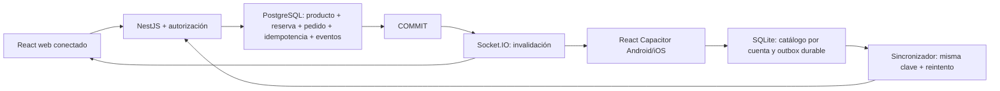

# Arquitectura y migración progresiva

REST y PostgreSQL son autoridad. Los dispositivos desconectados tienen estimaciones de catálogo, no existencias globales confirmadas. El servidor nunca confía en `paid`, precios/roles suministrados libremente o existencias del cliente. El contrato rechaza campos extra; compara precio esperado y calcula importes actuales y consumo base.

## Mapa de requisitos

| Requisito aprobado                           | Primer incremento                                                                | Próximo incremento                                                                       |
| -------------------------------------------- | -------------------------------------------------------------------------------- | ---------------------------------------------------------------------------------------- |
| Admin/vendedor/comprador                     | JWT firmado y roles consultados servidor; costo admin; comprador solo propios    | Identidades persistentes/OIDC o login, sesiones, refresh y revocación                    |
| Diseño marca y navegación aprobados          | Conservados íntegros en prototipo separado; nueva pantalla vertical              | Migrar componentes responsive, canasta/modal, campana y flujos aprobados                 |
| Productos/unidades/peso/libra/presentaciones | Esquema y consulta, gramos enteros, factores 1/15/30, precios propios, snapshot  | CRUD validado, ajustes/merma con auditoría y gestión de clientes                         |
| Stock/reservas/aceptación/preparación/pago   | Transacción, bloqueo, reserva, cancelación, entrega única, idempotencia          | Historial de ventas POS, conciliación/operación de caja, devoluciones                    |
| Cliente opcional/general                     | Snapshot nombre y referencia opcional                                            | Clientes persistentes y selección autorizada                                             |
| Pedidos recoger sin domicilio                | Único flujo de creación                                                          | Detalle móvil pulido y avisos accionables completos                                      |
| Offline Android/iPhone                       | Cola SQLite nativa implementada, SQL probado en SQLite real Node                 | Probar plugin con cierre forzado, red intermitente, reinstalación/backup en dispositivos |
| Web requiere conexión                        | Sin cola/persistencia offline web                                                | Manejo de disponibilidad/red y sesiones definitivo                                       |
| Conflictos                                   | Precio/stock/autorización explícitos; original conservado y nueva clave revisada | Editor de revisión de producto en lenguaje de negocio, no JSON                           |
| Nequi                                        | Método pendiente de integración; no hay confirmación falsa                       | Integración real con proveedor y confirmación verificable/idempotente                    |
| Horarios Bogotá y modo manual                | Requisitos preservados en referencia, aún no migrados a backend                  | Tablas/API de horario con America/Bogota y permisos                                      |
| Notificaciones Inventario/Pedidos            | Eventos durables, separación de visibilidad por cuenta/tienda                    | Clasificación, leídos por aviso y navegación al detalle con acciones                     |
| Hosting                                      | Nada desplegado                                                                  | Evaluar PostgreSQL/Node/HTTPS en alojamiento elegido; sin contratación actual            |

## Siguientes incrementos concretos

1. Levantar PostgreSQL real fuera del bloqueo de sandbox y aprobar la integración en local/CI; pruebas de precio cambiado, concurrencia, autorización, cancelación y pérdida de ack completas. Generar/probar plataformas nativas, configurar una API HTTPS alcanzable, secure storage y migraciones SQLite versionadas.
2. Implementar autenticación productiva, usuarios/clientes y CRUD/ajustes auditados; trasladar componentes aprobados por módulos sin tocar la demo. Mantener contratos y pruebas como límite de alcance.
3. Completar POS conectado, historial de ventas y reportes, horarios/notificaciones accionables, validación end-to-end en dispositivos. Resolver explícitamente política de POS offline antes de implementar ventas físicas sin red.
4. Integración Nequi real, conciliación e idempotencia de proveedor. Observabilidad, copias de seguridad, protección de datos y despliegue solo tras autorización específica.

## Limitaciones técnicas conocidas

- JWT local HS256 es base de autorización, no solución de identidad productiva.
- Idempotencia sin TTL ni purga aún; requieren retención documentada.
- Socket solo actualiza al reconectar por consultas REST completas; cursor REST existe, cliente incremental durable pendiente.
- Catálogo/pedidos listan conjuntos acotados; paginación completa pendiente.
- Este incremento no incluye importación de localStorage ni tratamiento de datos personales reales.
- Las pruebas de transporte doble verifican protocolo de outbox, no transacciones PostgreSQL. La integración real separada lo comprueba cuando hay `TEST_DATABASE_URL`.
